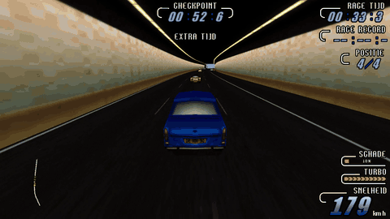
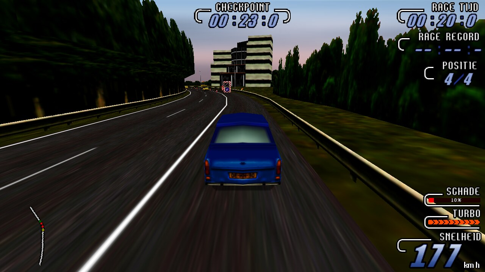
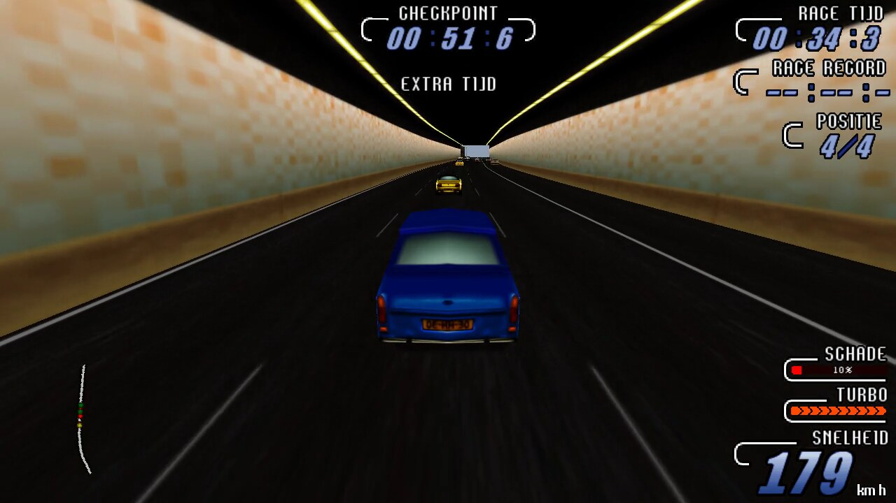
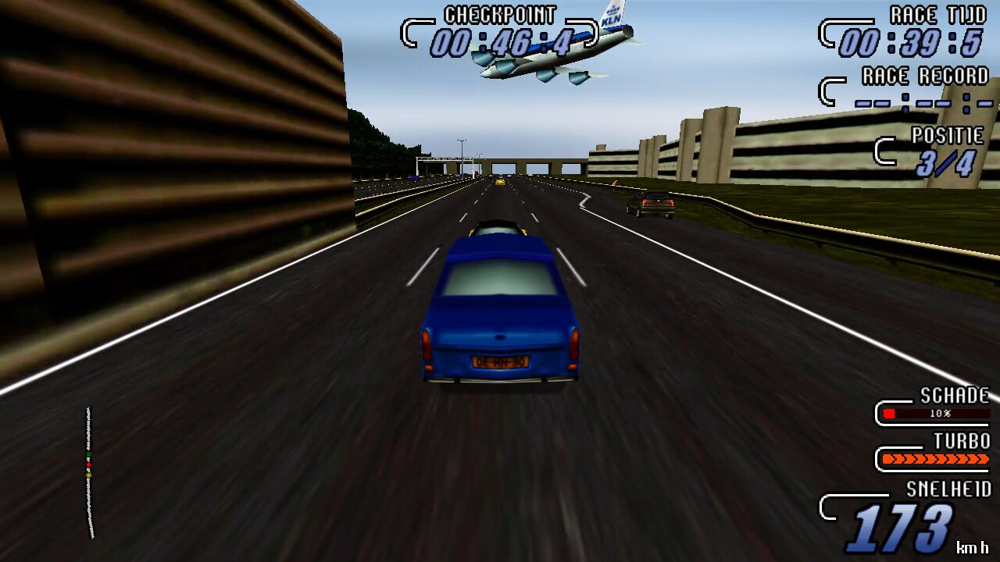

# A2 Racer II: reverse engineering and port

A study of the 1998 Windows racing game **A2 Racer II** (the Dutch release,
v1.01), and a reimplementation in C that plays it on Linux and in the browser.



The research half is notes on how the original works, worked out from its
binaries (mainly `spel.dat`, the renamed game executable) and from experiments
with it running under Wine. Each finding records the code addresses it rests on
and how sure it is.

The port is a new engine in C (SDL2, OpenGL) that reads the original game data
unchanged. It runs the whole game: the intro video, the menu, the races, the
results and the ending. The same sources build for the web with Emscripten.

<p>
  
  
  
</p>

All of these are the port, captured on the first stage, Amsterdam - Den Haag.

**The game itself is not included.** You need your own copy of A2 Racer II.
Nothing here changes or redistributes the original files. The research is done
on the Redump disc image *A2 Racer II (Netherlands) (v1.01)*, which the
Internet Archive keeps at
[archive.org/details/Redump.org14618](https://archive.org/details/Redump.org14618).

## Playing

You need CMake, a C compiler, SDL2 and OpenGL. Point the launcher at the game's
data directory (the installed game, or the `data` folder of the CD or the
extracted disc image: the one with `spel.dat` and `RCS.IMG`):

```sh
port/play.sh <game data dir>                # 1280x960 window
port/play.sh <game data dir> --fullscreen
port/play.sh <game data dir> --fresh        # forget the saved careers
```

It builds the port the first time. Your game directory is never written to:
the game plays from a copy in `~/.local/share/a2racer2` (or `$A2_PLAY_DIR`),
which also keeps your careers between runs.

### In the browser

```sh
port/web/build.sh    # needs Emscripten (emcc)
port/web/serve.sh    # then open http://localhost:8080/a2racer2.html
```

The page asks for your A2 Racer II folder once and keeps the files it needs
in the browser's storage.

## Layout

| Path | Contents |
|---|---|
| `research/discoveries.md` | What has been established, with evidence |
| `research/hypotheses.md` | Ideas that are not settled yet |
| `research/open-questions.md` | Open and resolved questions |
| `reverse-engineering/` | Reference docs: executables, file formats, game and menu architecture, running the original under Wine |
| `reverse-engineering/tools/` | Disassembly helpers, Unicorn emulation harnesses and gdb scripts used to check findings |
| `reverse-engineering/analysis/` | Function lists, source-file map and annotations taken from the binaries |
| `port/` | The C port; [`port/README.md`](port/README.md) is its detailed manual |
| `port/web/` | The WebAssembly build |
| `port/a2tools/` | Python tools for the game's archives, images, sprites and car data |

## How the research works

Each finding carries a label: CONFIRMED, STRONGLY SUPPORTED, LIKELY or
SPECULATIVE. The notes never present an inference as fact. Evidence from
the binaries and from runtime experiments comes before outside documentation.
Where the port's behaviour comes from the original, its source comments name
the address it was taken from, for example `0x4190d0` for the sky. Where the
port deliberately differs, `port/README.md` says so. The working rules are in
[`AGENTS.md`](AGENTS.md).

The original runs under Wine without the CD (it honours a `NOCD` environment
variable), which makes side-by-side comparisons possible; see
[`reverse-engineering/runtime-wine.md`](reverse-engineering/runtime-wine.md).

Some tools in `reverse-engineering/tools/` need Python 3 with `capstone`,
`pefile` and `unicorn`, and some run inside gdb.

## Status

The full game is playable from start to finish. The remaining differences
from the original are listed under "Known gaps" in `port/README.md`, and the
unanswered questions are in `research/open-questions.md`.

## License

This software is released under the [BOLA License](LICENSE). It covers this
project's own code and notes, not the game.

## Legal

A2 Racer II and its data are the property of their rights holders. This
project contains no game data and is meant for people who own the game.
